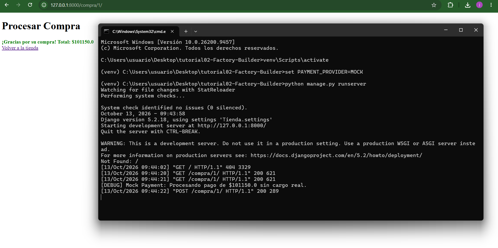

# Tutorial 02 - Patrones Creacionales en Django

Arquitectura de Software 2026 - EAFIT
Jeronimo Carvajal Zuluaga

Continuacion del Tutorial 01. Se agregan dos patrones creacionales:

- **Factory Method** (`tienda_app/infra/factories.py`): `PaymentFactory` decide que procesador de pago usar segun la variable de entorno `PAYMENT_PROVIDER`. Las vistas ya no crean el banco directamente.
- **Builder** (`tienda_app/domain/builders.py`): `OrdenBuilder` arma la orden paso a paso (usuario, productos, direccion) y valida antes de crearla. Se usa desde `CompraService`.

Para el Builder se agregaron los campos `usuario` y `direccion_envio` al modelo `Orden` (migracion 0002).

## Como correrlo

```
python -m venv venv
venv\Scripts\activate
pip install -r requirements.txt
python manage.py migrate
```

Modo normal (Banco Nacional, escribe en el .log):
```
python manage.py runserver
```

Modo pruebas (Mock, no cobra y muestra un mensaje en consola):
```
set PAYMENT_PROVIDER=MOCK
python manage.py runserver
```
(en PowerShell: `$env:PAYMENT_PROVIDER="MOCK"; python manage.py runserver`)

URLs para probar: `/compra/<id>/` y `/compra-rapida/<id>/`

## Evidencia del Mock

Compra en `/compra/1/` con `PAYMENT_PROVIDER=MOCK`:


